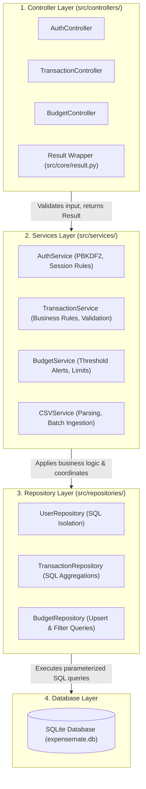

# 🏗️ Assignment 02 Deliverable: Refactoring Report
**Project:** ExpenseMate — Personal Expense Manager  
**Course:** Software Construction & Development  
**Concept Demonstrated:** Part B — Refactoring into Layered Architecture  
**Authors:** Muhammad Hashir (Member A), Muhammad Omer (Member B)  

---

## 1. Required Architecture Specification

Assignment 02 explicitly requires refactoring the application into the following 4-layer dependency model (prohibiting MVC as the main architecture for this task):

$$\text{Controller} \longrightarrow \text{Services} \longrightarrow \text{Repository} \longrightarrow \text{Database}$$

### Layer Responsibilities



- **Controller Layer (`src/controllers/`):** Receives user requests/actions from UI frames, validates basic input parameters (data types, positive numbers, required fields, date formats), invokes the relevant service, and returns a standardized `Result[T]` object. *Controllers contain zero raw SQL and zero database connections.*
- **Services Layer (`src/services/`):** Contains application and business rules, limit calculations, budget threshold evaluations, and coordination of operations. *Services contain zero UI widget code and zero direct SQL.*
- **Repository Layer (`src/repositories/`):** Handles all data persistence, parameterized SQL queries, connection lifecycle, and database aggregations. Returns typed domain entities (`User`, `Transaction`, `Budget`). *Repositories contain zero business calculations or UI logic.*
- **Database Layer:** SQLite database storing structured records.

---

## 2. Before vs. After Architecture Comparison

```
BEFORE (Assignment 01):
CustomTkinter UI Views ──> Services (Mixed logic & loops) ──> DAOs (Raw SQL) ──> SQLite DB
  - UI views calculated balances, parsed floats, and handled message dialogs directly.
  - Services ran in-memory date loops and directly called other static services.
  - No Controller layer existed.
  - No standardized response object (returned bare tuples or raised raw exceptions).

AFTER (Assignment 02 Refactored):
CustomTkinter UI Views ──> Controllers ──> Services ──> Repositories ──> SQLite DB
  - UI frames only capture input and display Result data/errors.
  - Controllers validate input presence/ranges and return Result[T].
  - Services focus strictly on business logic and inject Repositories.
  - Repositories handle all SQL queries and SQL aggregations.
```

---

## 3. Refactored Features Walkthrough

### Feature 1: Add & Manage Expense Transactions
1. **Presentation:** [`TransactionView`](file:///C:/Users/92313/Downloads/ExpenseMate/src/ui/views/transaction_view.py#L103-L128) reads form entries (`type`, `amount`, `date`, `category`, `currency`, `payment_method`) and invokes `TransactionController.create_transaction()`.
2. **Controller:** [`TransactionController.create_transaction()`](file:///C:/Users/92313/Downloads/ExpenseMate/src/controllers/transaction_controller.py#L23-L64) validates:
   - Amount is a positive float.
   - Category and date are non-empty.
   - Forwards cleaned data to `TransactionService.add_transaction()`.
3. **Service:** [`TransactionService.add_transaction()`](file:///C:/Users/92313/Downloads/ExpenseMate/src/services/transaction_service.py#L64-L117):
   - Validates ISO date format (`YYYY-MM-DD`).
   - Validates supported currency and payment method.
   - Invokes `TransactionRepository.create(transaction)`.
   - If an expense is added, invokes `TransactionRepository.get_monthly_spending()` to compute Month-To-Date spending via SQL aggregation, then triggers `BudgetService.check_alert()`.
4. **Repository:** [`TransactionRepository.create()`](file:///C:/Users/92313/Downloads/ExpenseMate/src/repositories/transaction_repository.py#L25-L50) executes parameterized `INSERT INTO transactions ...` and returns the persisted entity with its primary key ID.
5. **Database:** SQLite commits the new transaction row.

### Feature 2: Monthly Budget Summary & Threshold Alerting
1. **Presentation:** [`BudgetView`](file:///C:/Users/92313/Downloads/ExpenseMate/src/ui/views/budget_view.py#L55-L71) captures category, limit, and threshold percentage, invoking `BudgetController.set_budget()`.
2. **Controller:** [`BudgetController.set_budget()`](file:///C:/Users/92313/Downloads/ExpenseMate/src/controllers/budget_controller.py#L17-L52) validates:
   - Category is non-empty.
   - Monthly limit is positive float.
   - Alert threshold is between $1\%$ and $100\%$, converting to float ratio ($0.01$ to $1.0$).
3. **Service:** [`BudgetService.set_budget()`](file:///C:/Users/92313/Downloads/ExpenseMate/src/services/budget_service.py#L13-L37) creates a `Budget` entity and invokes `BudgetRepository.create_or_update()`.
4. **Repository:** [`BudgetRepository.create_or_update()`](file:///C:/Users/92313/Downloads/ExpenseMate/src/repositories/budget_repository.py#L19-L41) executes `INSERT INTO budgets ... ON CONFLICT(user_id, category) DO UPDATE SET ...` ensuring safe upsert behavior.
5. **Database:** Persists the budget. During subsequent expense additions, `TransactionRepository.get_monthly_spending()` computes actual spending directly in SQL, allowing `BudgetService.check_alert()` to return instant alert strings without scanning tables.

### Feature 3: User Authentication Workflow
`LoginFrame` $\longrightarrow$ `AuthController` $\longrightarrow$ `AuthService` $\longrightarrow$ `UserRepository` $\longrightarrow$ `Database`.

---

## 4. Code-Quality Improvements Made by Refactoring

1. **Elimination of UI Business Calculations & Coupling:**  
   In Assignment 01, `DashboardView.refresh_data()` fetched all transaction records into memory, iterated over them with Python list comprehensions to compute income, expenses, and net balance, and built dictionary maps. In Assignment 02, `DashboardView` calls `TransactionController.get_dashboard_summary()`, which delegates to `TransactionRepository.get_financial_summary()` to compute totals directly via SQL `SUM(CASE WHEN type = 'income' ...)`. Cyclomatic complexity of `DashboardView.refresh_data` dropped from **5** to **3**.
2. **Standardized Error Handling via `Result[T]` Pattern:**  
   Instead of raising unhandled exceptions or using raw string comparisons, all controllers return typed [`Result`](file:///C:/Users/92313/Downloads/ExpenseMate/src/core/result.py) objects (`Result.success(data)` or `Result.failure(error_message)`). UI components can cleanly check `result.is_success` and present dialogs without try/except blocks.
3. **Dependency Inversion & Testability:**  
   Services and controllers now accept repositories and services via constructor injection (`__init__(repo=None)` with sensible defaults). This enables 100% unit testability without relying on real SQLite database disk files, while preserving zero-config instantiation for the UI.

